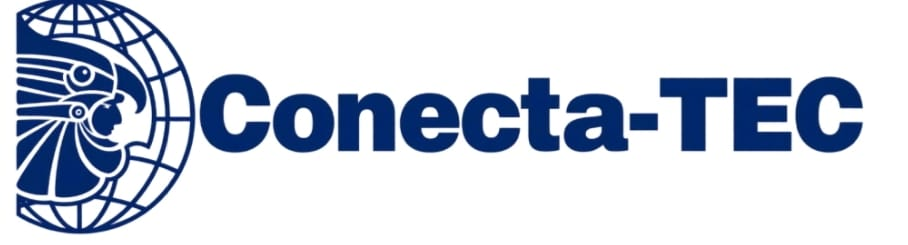

# Conecta-TEC

> Conecta con tu vida académica.

   

Aplicación web colaborativa para estudiantes del TecNM. Permite debatir, compartir conocimiento y colaborar en áreas técnicas y de nicho, usando un alias público para no exponer la identidad real. También le da a cada plantel un canal directo para avisos y difusión académica.

Proyecto desarrollado por estudiantes del Instituto Tecnológico de Ocotlán.

## Características

- Aplicación web, accesible desde el navegador en computadora o celular
- Acceso con correo institucional
- Perfil con alias público
- Moderación de contenido con IA
- Membresía VIP opcional
- Panel institucional de métricas y anuncios para los planteles

## Equipo

| Integrante | Rol |
|---|---|
| Emiliano Gael Alvarado Iñiguez | Backend (API REST) |
| Daniel Martínez de Arcos | Backend (API REST) |
| Oscar Uriel Ríos Díaz | Frontend y moderación con IA |
| Diego Alberto Luna Castillo | Frontend y moderación con IA |

## Stack

- **Backend:** Java, Spring Boot, PostgreSQL
- **Frontend:** HTML 5, Tailwind CSS, JavaScript
- **Moderación con IA:** DeepSeek
- **Arquitectura:** MVC

## Demo

Próximamente.

## Documentación

- [Arquitectura](conecta-tec-documentacion/docs/arquitectura.md)
- [Base de datos](conecta-tec-documentacion/docs/base-de-datos.md)
- [Endpoints de la API](conecta-tec-documentacion/docs/endpoints.md)

## Mi aporte

Desarrollo de la API del backend junto con Daniel: [usuarios, publicaciones, comunidades...].

## Estado

En desarrollo.

> El código fuente es privado. Este repositorio solo contiene la documentación del proyecto.
