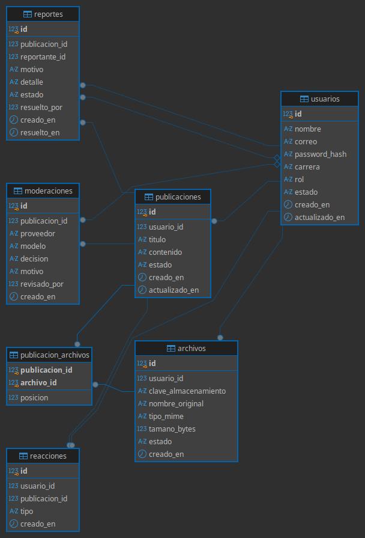
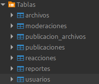

# Conecta Tec — Base de datos

> **Motor:** PostgreSQL  
> **Base identificada:** `conecta-tec-db`  
> **Herramienta de administración:** DBeaver

Este documento registra las tablas identificadas en la evidencia disponible. No se inventan columnas, tipos de datos ni restricciones que no se hayan podido verificar en el esquema.

## 1. Tablas identificadas

| Tabla | Propósito general |
|---|---|
| `usuarios` | Almacena la información de las cuentas de usuario. |
| `publicaciones` | Almacena las publicaciones creadas en la plataforma. |
| `archivos` | Registra información de archivos asociados al contenido. |
| `publicacion_archivos` | Relaciona publicaciones con archivos y permite representar su asociación/orden. |
| `moderaciones` | Registra información del proceso de moderación. |
| `reacciones` | Registra reacciones de usuarios a publicaciones. |
| `reportes` | Registra reportes realizados por usuarios. |

## 2. Relaciones conceptuales

Las siguientes relaciones describen el modelo funcional esperado. Los nombres exactos de las claves foráneas y sus cardinalidades deben contrastarse con el diagrama real de DBeaver.

- Un usuario puede crear varias publicaciones.
- Una publicación pertenece a un usuario.
- Una publicación puede asociarse con varios archivos.
- `publicacion_archivos` funciona como tabla intermedia entre publicaciones y archivos.
- Un usuario puede registrar reacciones en publicaciones.
- Un usuario puede generar reportes.
- Las moderaciones se relacionan con el proceso de revisión de publicaciones.

## 3. Diagrama entidad-relación

**Figura 1.** Diagrama relacional de la base de datos `conecta-tec-db`.

## 4. Tablas en PostgreSQL

**Figura 2.** Tablas identificadas en el esquema de la base de datos.

## 5. Detalle de columnas

El detalle de columnas se debe completar directamente desde el esquema real. Para cada tabla, registrar:

| Dato | Qué documentar |
|---|---|
| Columna | Nombre exacto de la columna. |
| Tipo | Tipo de dato PostgreSQL. |
| PK | Si forma parte de la clave primaria. |
| FK | Tabla y columna referenciada, si aplica. |
| Restricciones | `NOT NULL`, `UNIQUE`, `DEFAULT`, `CHECK`, etc. |

No se incluyen definiciones SQL de creación hasta verificar los nombres y tipos reales.

## 6. Consideraciones

- Las claves primarias y foráneas deben corresponder al esquema real.
- Los archivos pueden almacenarse físicamente fuera de PostgreSQL; la base puede conservar su ruta o identificador de almacenamiento.
- Las credenciales de conexión no deben publicarse en este documento ni subirse al repositorio.

## 7. Evidencias

Las capturas están en `docs/capturas/base-de-datos/`:

- `diagrama-relacional.png`
- `tablas-postgresql.png`
