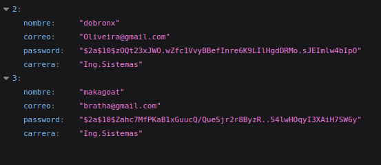
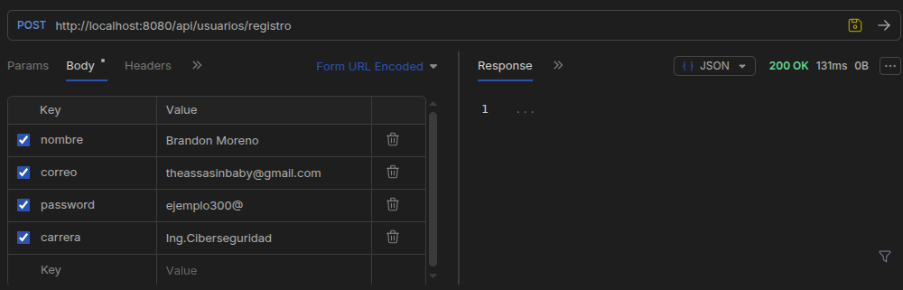
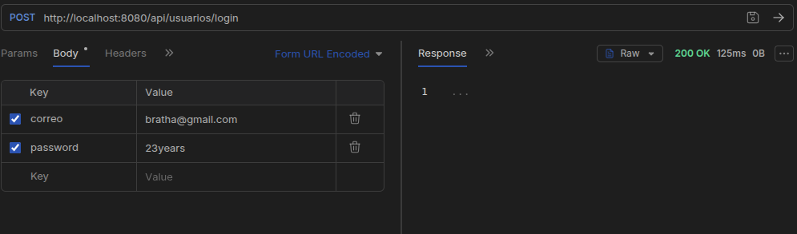

# Conecta Tec — Documentación de endpoints

> **Base URL local de referencia:** `http://localhost:8080`  
> Las rutas de esta documentación son únicamente las que aparecen en la evidencia disponible. No se agregan rutas supuestas.

## 1. Usuarios

### 1.1 Consultar usuarios

| Campo | Valor |
|---|---|
| Método | `GET` |
| Ruta | `/api/usuarios` |
| Descripción | Solicita la lista de usuarios al servicio. |
| Evidencia | Captura de respuesta GET en Bruno. |

**Ejemplo de solicitud**

```http
GET http://localhost:8080/api/usuarios
```

**Respuesta observada:** `200 OK`, con una respuesta que contiene datos de usuarios.



**Figura 1.** Respuesta de la consulta de usuarios.

### 1.2 Registrar usuario

| Campo | Valor |
|---|---|
| Método | `POST` |
| Ruta | `/api/usuarios/registro` |
| Descripción | Envía los datos necesarios para registrar un usuario. |
| Evidencia | Solicitud desde Bruno con formato Form URL Encoded y respuesta `200 OK`. |

**Campos identificados en la solicitud**

| Campo | Descripción |
|---|---|
| `nombre` | Nombre del usuario. |
| `correo` | Correo del usuario. |
| `password` | Contraseña enviada para el registro. |
| `carrera` | Carrera del usuario. |



**Figura 2.** Solicitud de registro en Bruno.

La evidencia disponible muestra el envío mediante **Form URL Encoded**. No se asume que el endpoint reciba JSON mientras eso no se confirme en el controlador.

### 1.3 Inicio de sesión

| Campo | Valor |
|---|---|
| Método | `POST` |
| Ruta | `/api/usuarios/login` |
| Descripción | Envía las credenciales para iniciar sesión. |
| Evidencia | Solicitud desde Bruno con respuesta `200 OK`. |

**Campos identificados**

| Campo | Descripción |
|---|---|
| `correo` | Correo asociado a la cuenta. |
| `password` | Contraseña enviada para validación. |



**Figura 3.** Solicitud de inicio de sesión en Bruno.

## 2. Resumen de rutas identificadas

| Método | Ruta | Operación | Estado de evidencia |
|---|---|---|---|
| `GET` | `/api/usuarios` | Consultar usuarios | Captura de Bruno disponible |
| `POST` | `/api/usuarios/registro` | Registrar usuario | Captura de Bruno disponible |
| `POST` | `/api/usuarios/login` | Iniciar sesión | Captura de Bruno disponible |

## 3. Pruebas

Las solicitudes se realizan con Bruno mientras el backend está ejecutándose localmente.

1. Iniciar Spring Boot.
2. Abrir la colección de Conecta Tec en Bruno.
3. Seleccionar el método HTTP correspondiente.
4. Escribir la URL local y configurar los parámetros o el body.
5. Enviar la solicitud.
6. Revisar el código HTTP y el contenido de la respuesta.

Un `200 OK` confirma que la solicitud recibió una respuesta satisfactoria a nivel HTTP; también se debe revisar que el contenido sea el esperado.

## 4. Operaciones no incluidas todavía

No se agregan rutas `PUT`, `DELETE`, consulta por ID ni endpoints de publicaciones porque no están confirmados en las capturas utilizadas para esta versión del documento. Si existen en el código actual, se pueden añadir después de verificar sus mappings y probarlos en Bruno.

## 5. Evidencias

Las capturas están en `docs/capturas/endpoints/`:

- `respuesta-usuarios.png`
- `post-registro.png`
- `post-login.png`

Los datos que aparecen en las capturas son de prueba.
